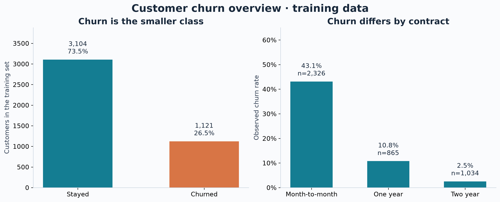
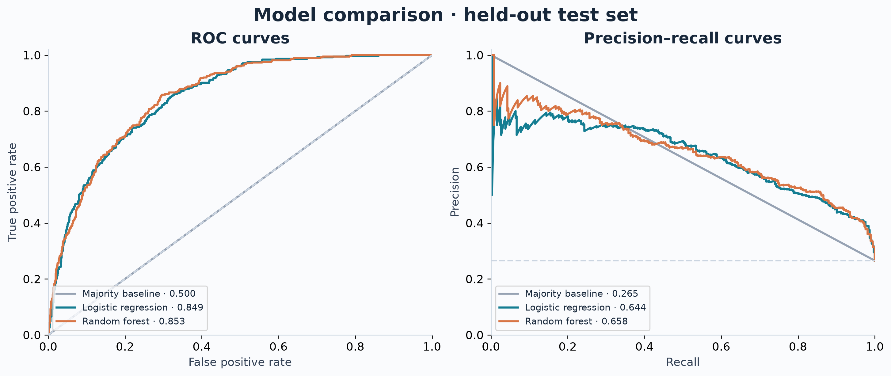
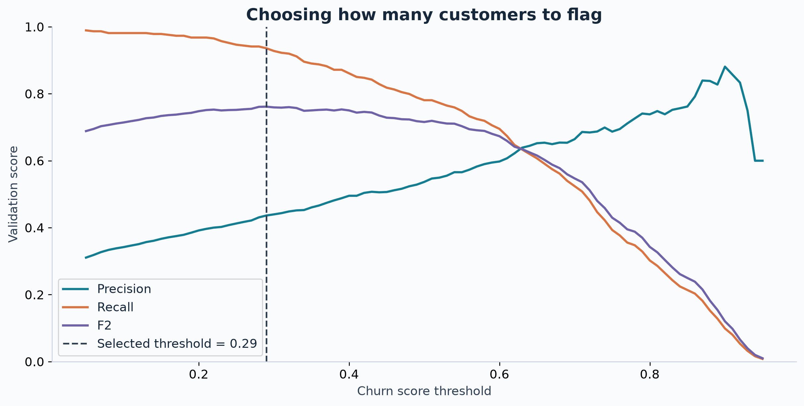

# Telco Customer Churn

This project started as a machine learning class assignment. I extended it to answer two questions: which model ranks customers at risk of churn most effectively, and what happens when the threshold is lowered to catch more churners?

I use the expanded IBM Telco sample with 7,043 customer records. The analysis compares a majority-class baseline, logistic regression and random forest, then examines the trade-off between missed churners and the number of customers flagged for contact.



## Main findings

- Random forest had the highest training cross-validation average precision: 0.689, compared with 0.685 for logistic regression. The small difference does not establish a clear winner across other samples.
- On the held-out test set, random forest achieved ROC-AUC of 0.853 and average precision of 0.658. Test churn prevalence was 26.5%, which provides context for average precision.
- At the default threshold of 0.50, random forest identified 78.3% of churners with 53.1% precision.
- A threshold of 0.29, chosen on validation data to maximize F2, raised test recall to 93.0%. It also flagged 56.1% of customers and reduced precision to 44.1%.
- Ranking customers and contacting the highest-scored 20% captured 50.3% of test-set churners. This measures shortlist coverage, not customers saved.

The lower threshold illustrates a recall-focused policy. A real team would also need a contact budget, offer cost and evidence that an intervention works before choosing an operating rule.

## Results

| model | threshold | precision | recall | f1 | roc_auc | average_precision |
| --- | --- | --- | --- | --- | --- | --- |
| Majority baseline | 0.500 | 0.000 | 0.000 | 0.000 | 0.500 | 0.265 |
| Logistic regression | 0.500 | 0.646 | 0.586 | 0.614 | 0.849 | 0.644 |
| Random forest | 0.500 | 0.531 | 0.783 | 0.633 | 0.853 | 0.658 |
| Random forest (validation threshold) | 0.290 | 0.441 | 0.930 | 0.598 | 0.853 | 0.658 |

All rows use the same 1,409 test customers. The first three use a 0.50 threshold. The final row uses the validation-selected threshold for the same fitted random forest. Ranking metrics do not change when only the threshold changes.



## How the experiment works

1. Check the workbook schema, customer IDs and target consistency. Convert blank Total Charges values to missing numeric values.
2. Keep 19 demographic, subscription and billing inputs. Exclude identifiers, geographic fields, duplicate outcome labels, Churn Reason, Churn Score and CLTV. The last two are derived values whose construction and availability are not established here.
3. Split customers into 60% training, 20% validation and 20% test data, with stratification and a fixed seed of 42. Explore patterns using training data only.
4. Fit imputers, scaling and one-hot encoding inside pipelines. Select the model using three-fold training cross-validation average precision. Search six random forest parameter combinations.
5. Choose a threshold on the validation set using F2, which gives recall more weight than precision. Keep the selected fitted model fixed; do not refit after threshold selection.
6. Evaluate the frozen model and threshold on the held-out test set. Export curves, confusion matrices, calibration checks, cumulative gains and permutation importance.

Scaling supports logistic regression. It is included in the shared preprocessing pipeline for consistency; random forests do not require it. Median imputation is learned from training data rather than assuming every missing Total Charges value is zero.



## Run it locally

Use Python 3.12, the version used for the saved run. From this project's root folder:

```bash
python3.12 -m venv .venv
source .venv/bin/activate
python -m pip install -r requirements.txt
```

Copy your `Telco_customer_churn.xlsx` into `data/raw/`, then run:

```bash
python -m src.churn
python -m unittest discover -s tests -v
jupyter notebook notebooks/telco_churn.ipynb
```

The command-line run and notebook share the same functions. Both regenerate `figures/` and `reports/`. The notebook can be read on GitHub using its saved outputs without installing anything.

You need the **33-column expanded workbook**. The common 21-column Kaggle CSV cannot be substituted without changing the loader. Dataset source notes and file requirements are in [data/README.md](data/README.md).

## Repository structure

```text
telco-churn-portfolio/
├── README.md
├── requirements.txt
├── data/                  # Dataset instructions; raw workbook ignored
├── notebooks/             # Executed analysis
├── src/                   # Reusable experiment code
├── figures/               # PNG and SVG figures
├── reports/               # Metrics, experiment metadata and findings
├── tests/                 # Evaluation and preprocessing checks
└── docs/                  # Project review and publishing guide
```

## What the results do not establish

This is a fictional sample, with one record per customer and no dated scoring history. The results describe classification of the recorded churn outcome. They do not validate an advance prediction window. For that, I would need features measured before a defined scoring date and outcomes observed afterward.

The figures show associations rather than causes. Contract type may help the model distinguish customers, but this experiment does not show that changing a customer's contract prevents churn. The calibration figure also checks how closely scores match observed rates; scores should not be treated as calibrated probabilities without further evaluation.

Bootstrap intervals in `reports/experiment.json` describe uncertainty from resampling the fixed test predictions. They do not include uncertainty from retraining, tuning or trying other splits. The best random forest CV result is a selection estimate, rather than an independent estimate of generalization.

## Next steps

With dated operational data, I would first evaluate on a later time period and define the prediction horizon. I would then compare a capacity-based shortlist with a cost-based policy and test whether retention offers change outcomes. More complex models would be useful only if they improve that evaluation.

## Author and references

Sara Kamyar. Originally developed for Machine Learning Applications in Business at Istinye University, then revised as a portfolio project.

- [IBM Telco customer churn sample and field definitions](https://community.ibm.com/community/user/blogs/steven-macko/2019/07/11/telco-customer-churn-1113?hlmlt=VT)
- [scikit-learn guidance on leakage and pipelines](https://scikit-learn.org/stable/common_pitfalls.html)
- [scikit-learn permutation importance](https://scikit-learn.org/stable/modules/permutation_importance.html)

The original class notebook and report were the starting material. This version changes the feature set and evaluation protocol, so its scores are not a controlled before-and-after comparison with the class report.
