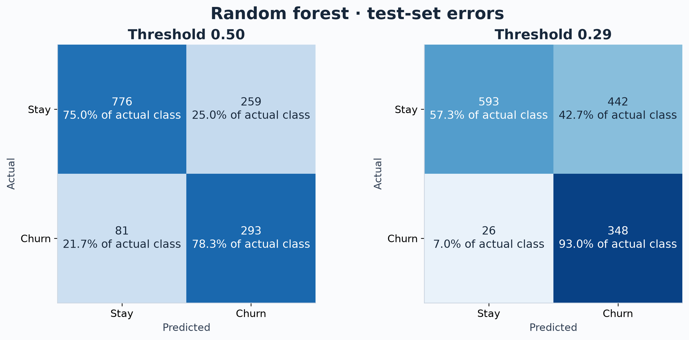
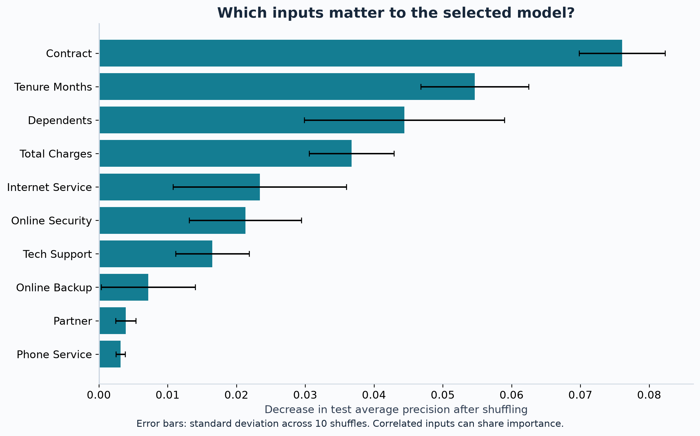
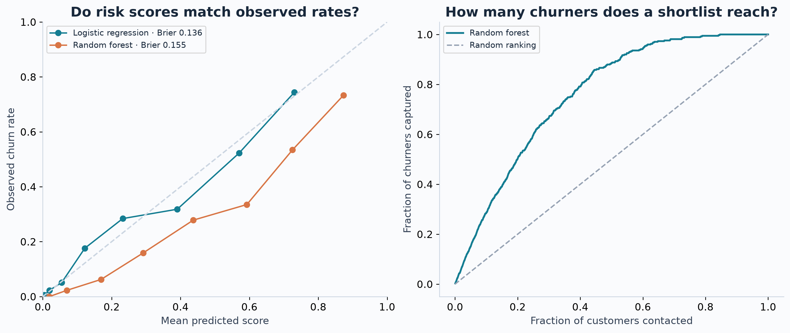

# Churn analysis findings

Sara Kamyar

## Question

Can demographic, subscription and billing variables help rank customers by their recorded churn outcome? How much does a recall-focused threshold increase the contact workload?

## Data and design

The supplied workbook contains 7,043 unique customers and 33 columns. After numeric conversion, 11 Total Charges entries are missing. The experiment uses 19 permitted inputs and excludes outcome information and derived values with unverified availability. It uses 4,225 training customers, 1,409 validation customers and 1,409 test customers.

EDA uses the training subset. The overview and tenure figures show higher observed churn among month-to-month and shorter-tenure customers. These are associations in the sample, not estimates of what would happen if a contract were changed.

## Model choice

Training cross-validation average precision is 0.689 for random forest and 0.685 for logistic regression. The forest is selected by the prespecified metric, but the difference is small relative to fold variation. No statistical superiority claim is made. The forest search chose `{'model__max_depth': 12, 'model__min_samples_leaf': 8}`.

## Held-out results

| model | threshold | precision | recall | f1 | roc_auc | average_precision |
| --- | --- | --- | --- | --- | --- | --- |
| Majority baseline | 0.500 | 0.000 | 0.000 | 0.000 | 0.500 | 0.265 |
| Logistic regression | 0.500 | 0.646 | 0.586 | 0.614 | 0.849 | 0.644 |
| Random forest | 0.500 | 0.531 | 0.783 | 0.633 | 0.853 | 0.658 |
| Random forest (validation threshold) | 0.290 | 0.441 | 0.930 | 0.598 | 0.853 | 0.658 |

The majority-class baseline reaches 73.5% accuracy while identifying no churners. This explains why accuracy alone is insufficient. Logistic regression has better default-threshold accuracy and precision, while the balanced forest has higher recall. Forest ROC-AUC is 0.853, with a 95% fixed-prediction bootstrap interval of 0.831 to 0.873. Average precision is 0.658, with interval 0.608 to 0.708. These intervals use 500 resamples and omit training and selection uncertainty.

## Threshold and capacity

Maximizing validation F2 selected a threshold of 0.29. On test data it identifies 93.0% of churners at 44.1% precision, with 56.1% of customers flagged. That contact rate may be impractical for a small team. It is an illustrative policy chosen without a real cost model. False positives can incur contact costs, discounts and customer fatigue; they should not be described as cost-free.

The highest-scored 20% of customers contain 50.3% of observed churners. This is a descriptive ranking result from the test set, not an optimized test-set policy or a claim of retained revenue.

## Interpretation and calibration

Permutation importance measures the decrease in average precision after shuffling each original feature. It describes model reliance, not a causal effect. The error bars show standard deviation across ten shuffles and are not confidence intervals. Correlated billing and tenure variables can share predictive information.

The calibration figure and Brier scores assess the fitted scores. Logistic regression has test Brier score 0.136, compared with 0.155 for the forest; lower is better. Calibration was inspected after model selection and did not determine the selected model. Calibration bins can be noisy, and no calibration correction was fitted using the test set.

## Limits and next experiment

The dataset is a fictional snapshot with no dated feature history. An advance churn prediction claim requires a defined scoring date, future horizon and temporal holdout. Geographic and derived score fields were excluded, and no offer outcomes are available. Retention savings, causal drivers, treatment effects and performance on a real customer population remain unmeasured.

The next meaningful extension is a temporal evaluation using dated records, followed by a budget-aware decision rule and a randomized offer test. The current project demonstrates a reproducible offline classification workflow.
